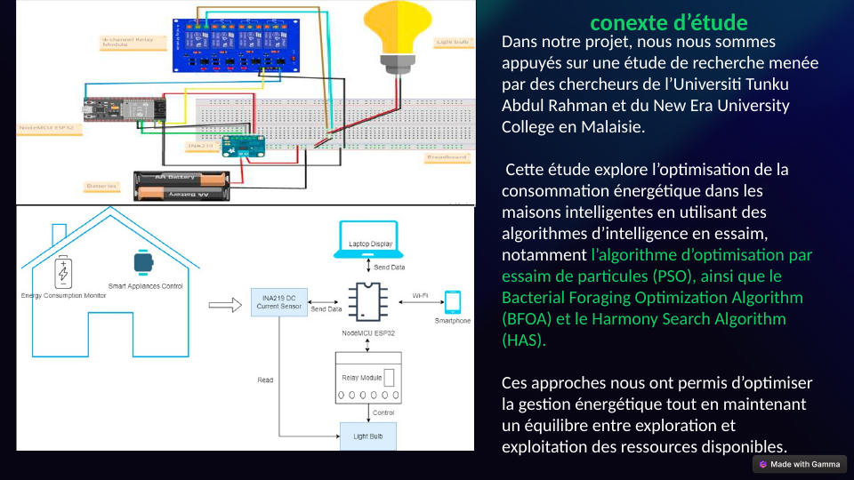
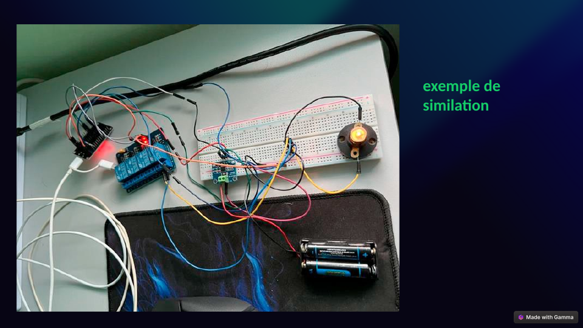
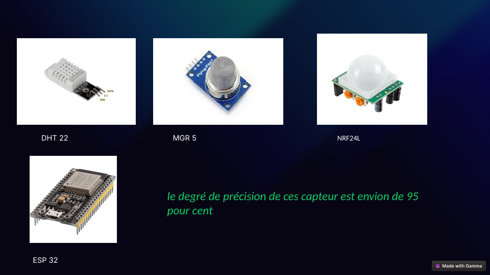
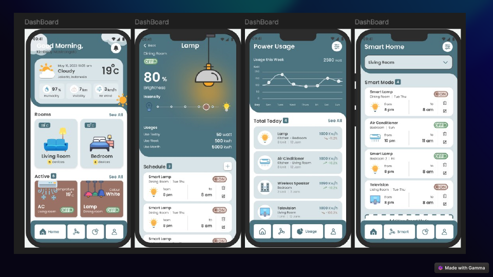
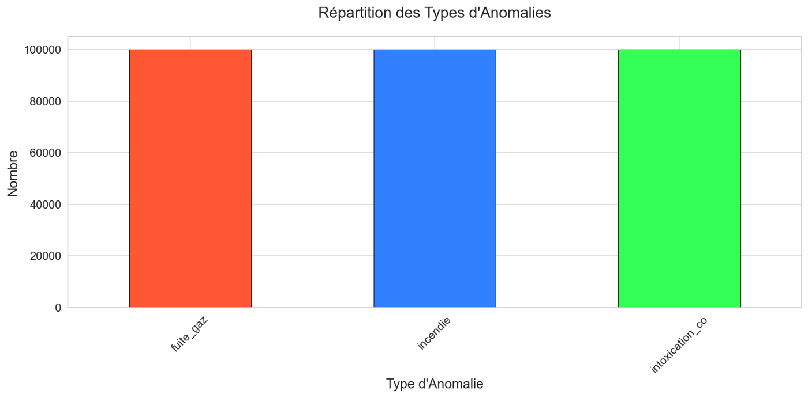
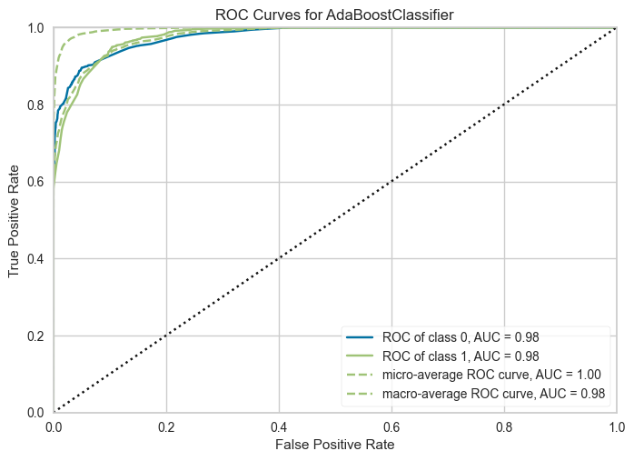
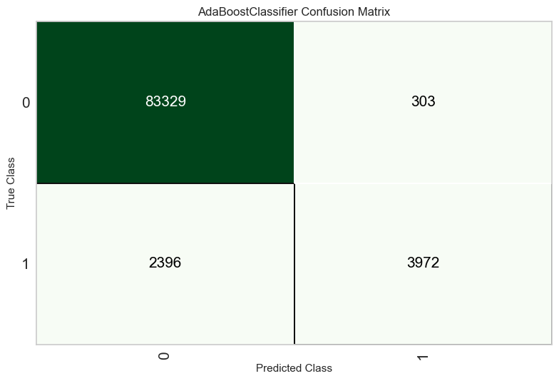
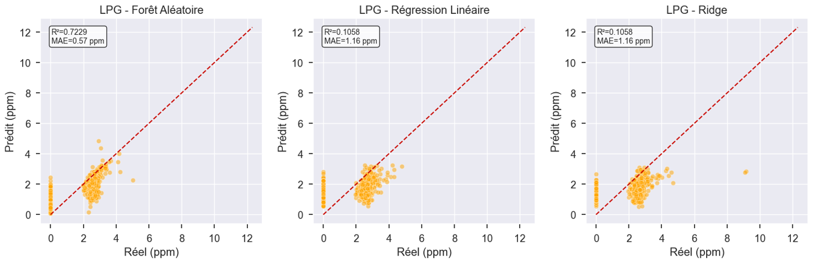
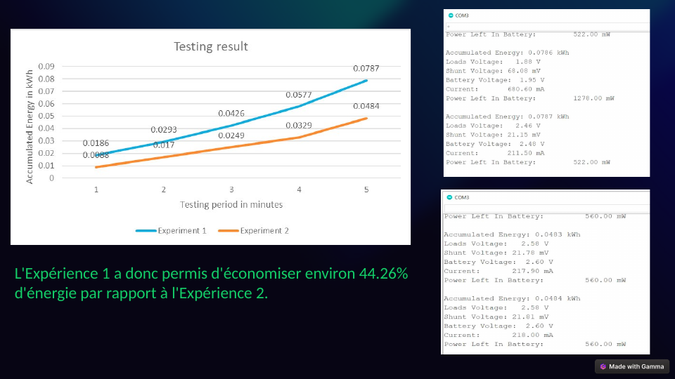

# Low-Cost Smart System for Home Safety and Comfort Using Machine Learning with Telemedicine and Human Supervision

[](certificates/ICDET2026_Certificate_of_Presentation.pdf)
[](https://chairconf.com/verify/certificate/cb99fab6-fdc8-4a76-a147-37565a6641ed)


**Fethi Nedale Lattab**¹ · **Naima Boukhiar**¹ · **Ghalem Belalem**¹ · **Amin Bouamar**¹
¹ LIO Laboratory, University of Oran 1, Oran, Algeria

Abstract presented by Naima Boukhiar at the **2026 International Conference on Digital &
Emerging Technologies (ICDET 2026)**, April 2–3, 2026, Leuven, Belgium.

| 📄 [Abstract](paper/ICDET2026_Abstract_Low_Cost_Smart_Home_Safety.pdf) | 🏅 [Certificate of presentation](certificates/ICDET2026_Certificate_of_Presentation.pdf) | 🔌 [Firmware](firmware/home_safety_node/home_safety_node.ino) | 📓 [ML notebook](notebooks/sensor_data_analysis_and_ml.ipynb) | 🖥️ [Slides (FR)](presentation/Smart_Home_AI_PFE_Presentation.pdf) |
|---|---|---|---|---|

---

## Abstract

Homes face hazards such as fires, gas leaks and carbon monoxide poisoning. This work presents
a **low-cost, intelligent home system** that uses machine learning for real-time anomaly
detection, predictive threat analysis and health monitoring. It adds **telemedicine** features
for elderly residents (vital signs, emotional state) and **human supervision**: timely alerts
to caregivers, emergency services and medical professionals. IoT sensors (flame, gas, motion,
heart rate, SpO₂) feed the system, and a mobile application handles instant alerts, remote
monitoring and emergency coordination. Further features include adaptive energy optimization
and automated hazard mitigation.

**Keywords:** home safety, IoT, machine learning, mobile application, telemedicine, elderly supervision

## System overview

<p align="center">
  
  
  <br><em>Left: circuit and architecture. Right: the hardware prototype.</em>
</p>

| Layer | Components |
|---|---|
| Sensing | DHT22 (temperature, humidity), MQ-5 (CH₄, LPG, H₂, CO), flame sensor, PIR motion (HC-SR501), GPS NEO, RFID MFRC522; health sensors (heart rate, SpO₂) |
| Actuation | Ventilation relay and buzzer, triggered automatically on flame detection |
| Storage | PostgreSQL database, one table per sensor plus alert and anomaly tables |
| Intelligence | Anomaly classification and sensor forecasting (PyCaret, scikit-learn) |
| Application | Mobile app for alerts, remote monitoring and supervision |

<p align="center">
  
  
  <br><em>Left: sensors and boards (DHT22, MQ-5, PIR, NRF24L01, ESP32). Right: mobile app screens.</em>
</p>

## Firmware

[`firmware/home_safety_node/home_safety_node.ino`](firmware/home_safety_node/home_safety_node.ino) runs on an Arduino board and, every 2 seconds:

- converts the MQ-5 reading into **CH₄, LPG, H₂ and CO concentrations (ppm)** with log-log sensor curves;
- reads temperature and humidity (DHT22);
- detects **flame** and, if present, **switches on ventilation and sounds the buzzer**;
- detects motion (PIR), reads GPS position, and checks **RFID cards** against an allow-list for access control;
- streams all readings over serial for logging to the database.

Libraries: `DHT sensor library`, `TinyGPSPlus`, `MFRC522`, `SPI`, `SoftwareSerial`.

## Machine learning

The notebook [`sensor_data_analysis_and_ml.ipynb`](notebooks/sensor_data_analysis_and_ml.ipynb) (comments in French) connects to the PostgreSQL sensor
database and covers exploration, cleaning, anomaly detection and forecasting. The database held
over 1.1 M DHT22 rows and 2.3 M MQ-5 rows, plus 300,006 hazard records spread over three types:
gas leak, fire and CO poisoning.

<p align="center">
  
</p>

### 1. Anomaly classification (temperature and humidity)

300,000 sampled DHT22 records, 7.05% labelled anomalous. PyCaret compared 15 classifiers:

| Model | Accuracy | AUC | Recall | Precision | F1 |
|---|---|---|---|---|---|
| **AdaBoost** (selected) | **0.969** | 0.979 | 0.624 | 0.911 | **0.740** |
| Gradient Boosting | 0.969 | 0.982 | 0.614 | 0.922 | 0.737 |
| LightGBM | 0.969 | 0.983 | 0.613 | 0.925 | 0.737 |
| k-NN | 0.966 | 0.927 | 0.658 | 0.824 | 0.732 |
| XGBoost | 0.966 | 0.980 | 0.651 | 0.822 | 0.726 |
| Dummy baseline | 0.930 | 0.500 | 0.000 | 0.000 | 0.000 |

<p align="center">
  
  
</p>

Because the classes are imbalanced, accuracy alone is misleading (the dummy baseline already
reaches 93%). F1 and recall are the better guide: the model catches about 62% of anomalies
with few false alarms.

### 2. Gas concentration forecasting (MQ-5)

About 95,000 cleaned readings, with lag features, a rolling mean and hour of day:

| Gas | Random Forest R² | Random Forest MAE (ppm) | Linear regression R² |
|---|---|---|---|
| CO | **0.776** | 0.38 | 0.278 |
| LPG | **0.723** | 0.57 | 0.106 |
| CH₄ | **0.718** | 0.63 | 0.097 |
| H₂ | **0.719** | 0.62 | 0.102 |

<p align="center">
  
</p>

### 3. Temperature and humidity forecasting (DHT22)

On 50,000 readings, the Random Forest reached **R² = 0.555** for temperature (MAE 0.79 °C) and
**R² = 0.748** for humidity (MAE 3.28 %), ahead of linear and ridge regression (R² 0.438 and 0.676).

## Energy optimization

The presentation also covers energy management with particle swarm optimization (PSO), based
on a published study of swarm-intelligence scheduling for smart homes. In the team's
simulation, the optimized scenario used **about 44% less energy** than the baseline. The
estimated hardware cost for five homes is about 245,200 DZD.

<p align="center">
  
</p>

## Repository contents

```
Smart_Home_Safety_ML/
├── paper/          ICDET 2026 abstract (PDF + preview)
├── certificates/   ICDET 2026 certificate of presentation (PDF + preview)
├── firmware/       Arduino sketch for the sensor node
├── notebooks/      data exploration, cleaning, anomaly detection and forecasting
├── data/           capteurs_sample_50000.sql, synthetic sample table for testing the pipeline
├── presentation/   project slides in French (PPTX + PDF)
└── figures/        selected results and slides
```

**About the data.** The full sensor database isn't included. `data/capteurs_sample_50000.sql`
is a **synthetic** test table (10 sensor IDs, values between 10 and 30, one reading every
15 minutes) for checking the PostgreSQL setup. To run the notebook, point the connection
settings at your own `capteurs` database.

## Credits

The firmware, notebook and slides come from an end-of-study project at the University of Oran 1,
*Conception d'une Maison Intelligente avec IA : Sécurité, Bien-être et Efficacité Énergétique*,
carried out by a student team and entered in the *State Competition for Youth Urban Innovation*.

## Related repositories

- [Towards_RealTime_Precision_Agriculture](https://github.com/naimabouk/Towards_RealTime_Precision_Agriculture): task-aware multi-modal decision framework (IEEE ISAIA 2026)
- [hurudza-iot-telemetry](https://github.com/naimabouk/hurudza-iot-telemetry): ESP32 multi-sensor field node
- [Autonomous_Mobile_Robot_RL_Navigation](https://github.com/naimabouk/Autonomous_Mobile_Robot_RL_Navigation): hybrid DQN + REINFORCE robot navigation (ICECET 2022)

## Citation

```bibtex
@inproceedings{lattab2026lowcost,
  title     = {Low-Cost Smart System for Home Safety and Comfort Using Machine Learning
               with Telemedicine and Human Supervision},
  author    = {Lattab, Fethi Nedale and Boukhiar, Naima and Belalem, Ghalem and Bouamar, Amin},
  booktitle = {International Conference on Digital \& Emerging Technologies (ICDET)},
  address   = {Leuven, Belgium},
  year      = {2026},
  note      = {Abstract}
}
```

## Contact

Naima Boukhiar, High School of Computer Science ESI · naima.boukhiar@univ-alger.dz
